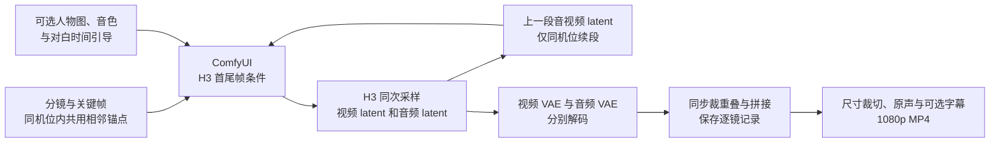

<p align="center">
  
</p>

# 无垠长卷 · Boundless Scroll

**从几张关键帧开始，让镜头和原声一起接续。**

无垠长卷是一个本地视频制作工作流。它用 MiniMax H3 和 ComfyUI 将首尾关键帧转成带原声的镜头，用上一段的运动上下文衔接同机位续镜，最后输出原生 1080p 成片。名字借了《封神演义》里山河社稷图的意象，一幅展开的长卷里可以有自己的天地。[《封神演义》第九十二回](https://zh.wikisource.org/wiki/封神演義/卷092)

- **从图片到原声音画**。用 FL2VA 给出首尾帧，H3 同次采样生成视频和立体声。
- **接着上一段拍**。相邻镜头共享锚点。Motion Context 承接上一段的音视频 latent，导出时将重复画面和对应原声同步裁掉。
- **人物和对白可参考**。Ref2VA 可以同时接收人物图、音色参考、首尾帧和对白时间引导。
- **面向成片**。可按原声对齐字幕。逐集验收原生尺寸、H3 原声、口型和面部质量。[交付标准](AGENTS.md)

## 实现工作流



`from_frames.py` 可把顺序图转换成清单。清单里每组是一段连续机位，`groups[].frames` 存关键帧，`groups[].segments` 存每段的提示词、帧数和可选音频引导。遇到反打、机位变化或场景变化时新建一组。组与组之间直接切镜。

`run_workflow.py` 上传素材、提交 ComfyUI 任务、保存每段 MP4 和采样记录。上段的 latent 由 ComfyUI 保存，续段从对应位置加载。脚本以实际输出帧数建立时间线，FFmpeg 按同一剪点拼接视频和音频。`finish_episode.py` 可用已生成对白的词时间戳对齐中文字幕。

第 1 集曾以 **24 个原生镜头、1818 帧、75.75 秒**验证这套流程。成片为 1080×1920、24 fps，20 段可见对白经成片检测均在 0 至 1 帧以内。下方入门样例是单独制作的三张静物图，适合先验证两段续接和原声链路。

## 1. 准备环境

以下命令面向 **Linux 虚拟环境**。本地实测环境为 Ubuntu 26.04、Python 3.13、RTX 5090（32 GB 显存）、64 GB 系统内存、CUDA 13.0 版 PyTorch 和 FFmpeg 8。其他显卡可以从短镜头测试起。镜头时长、采样尺寸、显卡和系统内存都会影响能否完成采样。

FL2VA 的五份权重合计约 **44 GB**，加装 Ref2VA 组合后约 **67 GB**。为 Python 环境、缓存和视频中间件预留空间，建议使用至少有约 100 GB 可用空间的 SSD。

在 Ubuntu 或 Debian 系统上安装 Git、FFmpeg 和中文字幕字体。先确认 NVIDIA 驱动和显卡可见。然后按 uv 安装说明准备命令 `uv`，后面的安装步骤会用它准备 Python 3.13。[uv 安装文档](https://docs.astral.sh/uv/getting-started/installation/)

```bash
sudo apt update
sudo apt install -y git curl ffmpeg fonts-noto-cjk
nvidia-smi
ffmpeg -version
```

如果还没有 uv，可以使用它的官方安装脚本。

```bash
curl -LsSf https://astral.sh/uv/install.sh | sh
export PATH="$HOME/.local/bin:$PATH"
uv --version
```

## 2. 下载源码并安装 ComfyUI

```bash
export SCROLL_HOME="$HOME/boundless-scroll-workspace"
mkdir -p "$SCROLL_HOME"

git clone https://github.com/jx1100370217/BoundlessScroll.git "$SCROLL_HOME/BoundlessScroll"
git clone https://github.com/Comfy-Org/ComfyUI.git "$SCROLL_HOME/ComfyUI"

export SCROLL_PROJECT="$SCROLL_HOME/BoundlessScroll"
export COMFYUI_DIR="$SCROLL_HOME/ComfyUI"
git -C "$COMFYUI_DIR" checkout --detach 95d755cd8107a72258d452b5d3657273d571f07d

uv python install 3.13
uv venv --python 3.13 --seed "$COMFYUI_DIR/.venv"
export COMFYUI_PYTHON="$COMFYUI_DIR/.venv/bin/python"
```

上述 ComfyUI 提交是本次验证所用核心的上游基线，版本为 0.34.0，包含 H3 的图生视频、参考生视频、引导和音视频 VAE 节点。下面是与实测环境一致的 Linux CUDA 13.0 安装组合。显卡驱动或平台需要其他 CUDA 构建时，按 PyTorch 安装器选择对应轮子，并检查 CUDA 可用性。[ComfyUI 核心](https://github.com/Comfy-Org/ComfyUI/commit/95d755cd8107a72258d452b5d3657273d571f07d) · [PyTorch 安装说明](https://pytorch.org/get-started/locally/)

```bash
"$COMFYUI_PYTHON" -m pip install   torch==2.13.0 torchvision==0.28.0 torchaudio==2.11.0   --index-url https://download.pytorch.org/whl/cu130
"$COMFYUI_PYTHON" -m pip install -r "$COMFYUI_DIR/requirements.txt"
"$COMFYUI_PYTHON" -m pip install -r "$SCROLL_PROJECT/requirements.txt"

"$COMFYUI_PYTHON" -c   'import torch; assert torch.cuda.is_available(), "CUDA unavailable"; print(torch.__version__, torch.cuda.get_device_name())'
```

安装唯一必需的自定义节点 **ComfyUI-H3-Motion-Context**。启动器使用项目自己的 ComfyUI 运行目录，因此节点装在项目下的 `runtime/comfy/custom_nodes/`。[Motion Context 验证版本](https://github.com/NikoDemon80/ComfyUI-H3-Motion-Context/tree/5335715abe54c1a9bfbe3494da29aae3e8635ce3)

```bash
export SCROLL_NODES="$SCROLL_PROJECT/runtime/comfy/custom_nodes"
mkdir -p "$SCROLL_NODES"
git clone https://github.com/NikoDemon80/ComfyUI-H3-Motion-Context.git   "$SCROLL_NODES/ComfyUI-H3-Motion-Context"
git -C "$SCROLL_NODES/ComfyUI-H3-Motion-Context" checkout --detach   5335715abe54c1a9bfbe3494da29aae3e8635ce3
```

## 3. 获取并配置模型

先准备 FL2VA。以下名字是工作流加载器实际使用的文件名，保留文件名和子目录即可。模型来源为 Comfy-Org 的 ComfyUI 权重包，FL2VA 加速 LoRA 来自 LightX2V。[Comfy-Org 模型包](https://huggingface.co/Comfy-Org/MiniMax-H3) · [LightX2V Turbo v1.0](https://huggingface.co/lightx2v/Minimax-h3-Turbo/blob/a29e57d195f80ead07c89f89e55ecf2911e893c5/minimax_h3_fl2v_turbo_4step_v1.0_768p_comfyui_bf16.safetensors)

| 类别 | 文件名 | 相对 `models/` 的目录 |
| --- | --- | --- |
| FL2VA 扩散主模型 | `minimax_h3_fl2va_pruned_int8_convrot.safetensors` | `diffusion_models/` |
| Qwen3-VL 文本编码器 | `qwen3vl_32b_minimax_h3_nvfp4_awq.safetensors` | `text_encoders/` |
| H3 视频 VAE | `minimax_h3_video_vae_fp16.safetensors` | `vae/` |
| H3 音频 VAE | `minimax_h3_audio_vae_fp32.safetensors` | `vae/` |
| FL2VA Turbo LoRA | `minimax_h3_fl2v_turbo_4step_v1.0_768p_comfyui_bf16.safetensors` | `loras/` |

LoRA 文件名里的 `768p` 是上游适配器标记。项目以 0.8 强度、8 步、Euler 采样运行，实际宽高由 H3 节点输入决定。入门样例的 H3 采样尺寸为 1088×1920，导出左右各裁 4 像素得到 1080×1920。

使用 Hugging Face CLI 可一次下载这五份模型。ComfyUI 的 Python 环境会安装 Hugging Face 依赖。如果 `hf` 命令尚未安装，先运行 `"$COMFYUI_PYTHON" -m pip install huggingface_hub`。如模型页要求接受条款，在同一 Hugging Face 账号下完成后执行 `"$SCROLL_HF" auth login`。[Hugging Face 下载命令](https://huggingface.co/docs/huggingface_hub/en/guides/cli#hf-download)

```bash
export SCROLL_HF="$COMFYUI_DIR/.venv/bin/hf"
export COMFYUI_MODELS_DIR="$COMFYUI_DIR/models"

"$SCROLL_HF" download Comfy-Org/MiniMax-H3   diffusion_models/minimax_h3_fl2va_pruned_int8_convrot.safetensors   text_encoders/qwen3vl_32b_minimax_h3_nvfp4_awq.safetensors   vae/minimax_h3_video_vae_fp16.safetensors   vae/minimax_h3_audio_vae_fp32.safetensors   loras/minimax_h3_fl2v_turbo_4step_v1.0_768p_comfyui_bf16.safetensors   --local-dir "$COMFYUI_MODELS_DIR"
```

如果已有同名权重，将 `COMFYUI_MODELS_DIR` 指向包含上述子目录的模型库即可。ComfyUI 直接读取该目录。

### 可选模型与其用途

- **Ref2VA 和 Pika H3 Flex** 用于人物图、音色和首尾帧混合引导。仍使用同一套 Qwen3-VL 和音视频 VAE。在第 6 节按需安装。
- **ChatGPT Images 2.5 Sunburst** 是制作样片采用的关键帧生图路线。已有 `novel-h3-studio` 的操作者可以通过 `make_keyframes.py <image-plan.json> --studio /你的/novel-h3-studio` 复用其已登录的 `codex_image` 工具。入门样例直接使用仓库中的静物图，自己的镜头也可使用本地图片。[ChatGPT Images 2.5](https://openai.com/index/introducing-chatgpt-images-2-5/)
- **Qwen3-TTS 12Hz 1.7B VoiceDesign / Base** 可分别制作参考声线和时序引导 WAV。按 Qwen 的安装说明配置环境和下载权重，或录一条自己的引导音频。听到的成片对白来自 H3 音频 VAE。[Qwen3-TTS](https://github.com/QwenLM/Qwen3-TTS) · [VoiceDesign 权重](https://huggingface.co/Qwen/Qwen3-TTS-12Hz-1.7B-VoiceDesign) · [Base 权重](https://huggingface.co/Qwen/Qwen3-TTS-12Hz-1.7B-Base)
- **faster-whisper-large-v3-turbo** 用于复核中文台词和提取字幕词时间戳，制作样片另外用 small 模型复核了部分片段。第 5 节提供安装和运行命令。[large-v3-turbo 权重](https://huggingface.co/mobiuslabsgmbh/faster-whisper-large-v3-turbo) · [small 权重](https://huggingface.co/Systran/faster-whisper-small)
- **Real-ESRGAN x4plus、SyncNet 和 YuNet** 是样片的可选辅助工具。Real-ESRGAN 用于准备部分关键帧静图，SyncNet 和 YuNet 分别用于成片的唇音时差测量和人脸定位。相应权重和使用方式在原作者项目中提供。首次跑通时，用播放器逐镜检查也可以验收。[Real-ESRGAN x4plus](https://github.com/xinntao/Real-ESRGAN/releases/download/v0.1.0/RealESRGAN_x4plus.pth) · [SyncNet 与权重获取](https://github.com/joonson/syncnet_python) · [YuNet 模型与示例](https://github.com/opencv/opencv_zoo/tree/main/models/face_detection_yunet)

## 4. 首次跑通

### 终端一启动 ComfyUI

沿用第 2、3 步的环境变量，在项目目录执行以下命令。这些参数是 32 GB 显存与 64 GB 内存机器上生成原生 1080p 样片时使用的设置。

```bash
cd "$SCROLL_PROJECT"
./start_comfy.sh --reserve-vram 3.5 --preview-method none   --disable-pinned-memory --cache-none --fast-disk
```

看到 `Starting server` 后，访问 [本机 ComfyUI](http://127.0.0.1:8189)。终端一保持运行。启动器的端口可通过 `COMFYUI_PORT` 设置。若只想确认节点和模型列表，可以加 `--cpu` 启动后执行下一步的 `check_setup.py`。

### 终端二预检并生成

打开第二个终端，设置项目路径、Python 和 ComfyUI 地址。

```bash
export SCROLL_HOME="$HOME/boundless-scroll-workspace"
cd "$SCROLL_HOME/BoundlessScroll"
export COMFYUI_URL="http://127.0.0.1:8189"
export SCROLL_PYTHON="$SCROLL_HOME/ComfyUI/.venv/bin/python"

"$SCROLL_PYTHON" check_setup.py
"$SCROLL_PYTHON" run_workflow.py examples/starter/project.json --output renders/starter
```

`check_setup.py` 检查 FFmpeg、H3 节点和模型下拉列表。预检通过后，生成器会让画面里的朱色漆珠从左向右滚过木案。两段各采样 56 帧，续段裁去 5 帧的重叠部分，最后得到 **107 帧，约 4.46 秒**。

- `renders/starter/delivery_1080p.mp4` 是可以直接播放的 1080×1920 立体声成片。
- `renders/starter/visual.mp4` 是裁边前的连续音画母版，尺寸为 1088×1920。
- `renders/starter/timeline.json` 保存每段的采样帧数、裁切后帧数和起止帧。
- `renders/starter/clips/` 保存剪接后的镜头和对应的 ComfyUI 回执。使用相同素材、参数、运行目录和输出目录复跑时，脚本可复用相符的镜头及上下文。

检查成片的尺寸、帧率和音轨，然后完整播放一次，听木案上的滚动声是否和珠子的动作接续。

```bash
ffprobe -v error -show_entries stream=codec_type,width,height,r_frame_rate,nb_frames,channels   -of json renders/starter/delivery_1080p.mp4
```

## 5. 换成自己的关键帧、对白和字幕

### 关键帧与连续机位

1. 准备两张或更多图片，按 `01.png`、`02.png`、`03.png` 排列。同角色和同机位保持相同的造型、光源、视线和物体位置。
2. 每对相邻图片定义一段。三张图得到两段，第二张同时是第一段的尾帧与第二段的首帧。换机位时在项目 JSON 里另起一个 `groups` 条目。
3. 通过命令生成清单。 `--lengths` 接受单个帧数或按段排列的逗号列表。`--prompts` 可接收每段一行的 UTF-8 文本，复杂场景可以直接编辑 JSON 里的 `prompt`。
4. 默认以 24 fps 采样。单段帧数按 `17n+5` 对齐，常用 39、56 或 73。横屏使用 `--size 1920 1088`。追加 `--loop` 会在序列末端接回第一张图片。

```bash
mkdir -p my-scene/frames
# 把准备好的图片放入 my-scene/frames 后，运行下面两条命令。
"$SCROLL_PYTHON" from_frames.py my-scene/frames   --master "A quiet continuous shot, gentle morning light and natural room tone."   --lengths 56 --output my-scene/project.json

"$SCROLL_PYTHON" run_workflow.py my-scene/project.json --output renders/my-scene
```

### 用参考声音引导 H3 说台词

在该段的 JSON 中保留原有的 `id`、`num_frames` 和 `prompt`，再增加 `guide_audio` 与 `speech_text`。路径相对于项目 JSON 所在目录。 `guide_audio` 为给模型的参考 WAV，`speech_text` 为字幕和台词核对使用的原文。

```json
{
  "id": "S001",
  "num_frames": 56,
  "prompt": "integrated_multimodal_description: [Shot 1] In a quiet room, the person speaks gently in sync with the supplied audio.\n\noverall_soundscape: Close dialogue and soft room tone.\n\nnon_diegetic_music: N/A",
  "guide_audio": "voice/line01.wav",
  "speech_text": "这里的风真轻。"
}
```

选择口齿清楚、带自然停顿的录音，录下的整句应能放进该镜头的时间内。`context_length` 为 5 时，同机位续段的参考 WAV 在开头预留 5/24 秒，程序会裁掉这段引导头并将剩余声音放在续段的正确位置。模型输出的人声、动作声和环境声从同一次 H3 采样中解码。

需要随原声定位字幕时，在完成该场戏的渲染后安装转写依赖并运行封装。 `faster-whisper` 在 CPU 上运行，权重保存在 Hugging Face 缓存。模型转写需与 `speech_text` 吻合，随后输出带字幕的 MP4 和独立 SRT。

```bash
"$SCROLL_PYTHON" -m pip install faster-whisper pypinyin
"$SCROLL_HOME/ComfyUI/.venv/bin/hf" download mobiuslabsgmbh/faster-whisper-large-v3-turbo

"$SCROLL_PYTHON" finish_episode.py my-scene/project.json   --render renders/my-scene --output renders/my-scene/episode.mp4
```

## 6. 在 ComfyUI 中使用 Ref2VA 参考生视频

用这一条路线让同一角色的图像和声线参与首尾帧生成。先完成基础安装，再增加 Ref2VA 主模型和 Pika 的匹配 LoRA。[Ref2VA 主模型](https://huggingface.co/Comfy-Org/MiniMax-H3/blob/main/diffusion_models/minimax_h3_ref2va_pruned_int8_convrot.safetensors) · [Pika H3 Flex Ref2VA LoRA](https://huggingface.co/Pika-Labs/Pika-H3-Flex/blob/main/comfy/loras/pika_h3_flex_ref2va_comfy_bf16.safetensors)

```bash
"$SCROLL_HF" download Comfy-Org/MiniMax-H3   diffusion_models/minimax_h3_ref2va_pruned_int8_convrot.safetensors   --local-dir "$COMFYUI_MODELS_DIR"

"$SCROLL_HF" download Pika-Labs/Pika-H3-Flex   comfy/loras/pika_h3_flex_ref2va_comfy_bf16.safetensors   --local-dir "$SCROLL_HOME/pika-download"

install -m 0644   "$SCROLL_HOME/pika-download/comfy/loras/pika_h3_flex_ref2va_comfy_bf16.safetensors"   "$COMFYUI_MODELS_DIR/loras/pika_h3_flex_ref2va_comfy_bf16.safetensors"
```

1. 重启 ComfyUI，运行 `"$SCROLL_PYTHON" check_setup.py --ref2va`。
2. 在网页中导入 [Ref2VA 工作流模板](workflows/ref2va-image-audio-guide.json)。
3. 在对应加载节点中选择自己的开镜图片 `head.png`、落镜图片 `tail.png`、人物参考 `subject.png`、音色样本 `voice-reference.wav` 和对白引导 `dialogue-guide.wav`。也可以先把这些文件放到 `runtime/comfy/input/`。
4. 在 Ref2VA 节点编辑提示词。模板里 `<Picture 1>` 是人物参考，`<Audio 1>` 是音色样本。将 `<d>[Chinese] 这里的风真轻。</d>` 改为引导 WAV 中的实际台词。两张关键帧由 `MiniMaxH3AddGuide` 分别固定在第 0 帧和末帧。另一个引导节点放置对白。
5. 点击 **Queue**。模板用 56 帧、6 步、Pika LoRA 强度 1.0 运行。输出位于 `runtime/comfy/output/boundless-scroll/ref2va/`，包括最终裁边的 1080p MP4 和一份 H3 原声 FLAC。

如需将自己的 FL2VA 清单导出为可拖入编辑器的画布，在 ComfyUI 运行时执行以下命令。浏览器用于把 API 图转换为 ComfyUI 的画布格式。

```bash
"$SCROLL_PYTHON" -m pip install playwright
"$SCROLL_PYTHON" -m playwright install chromium
"$SCROLL_PYTHON" export_ui.py my-scene/project.json --output my-scene/workflow.json
```

## 7. 交付前核对

1. 查每镜回执和成片的宽高。竖屏交付 1080×1920，横屏交付 1920×1080。采样尺寸须达到对应交付尺寸。
2. 确认声音由相同采样器的音频 latent 解码而来。复核人声、环境声及动作声在剪点附近是否自然，声音调整以剪接、时序和电平为主。
3. 播放编码后的 MP4，逐镜核对可见嘴型、对白和动作声，并检查主要台词齐全。
4. 逐镜检查人脸的清晰度与五官比例。说话、转头和侧脸优先放大检查。问题镜头返修后放回成片复验。[逐集验收规则](AGENTS.md)

## 常见问题

**连接不上 ComfyUI。** 确认终端一正在服务，终端二的 `COMFYUI_URL` 与端口一致。可以用 `curl --noproxy '*' http://127.0.0.1:8189/system_stats` 查看服务响应。

**图中缺少节点。** 核对 ComfyUI 的版本，以及自定义节点是否位于 `runtime/comfy/custom_nodes/ComfyUI-H3-Motion-Context`。重启后看启动日志和 `check_setup.py` 的结果。

**加载器找不到模型。** 检查 `COMFYUI_MODELS_DIR` 是否指到包含 `diffusion_models`、`text_encoders`、`vae` 和 `loras` 的目录。Pika 的 LoRA 需要从下载目录移到 `loras/`。下载完成后重启 ComfyUI。

**采样时内存压力过高。** 先用单段 39 或 56 帧测试，保留原生 1080p 采样宽高。端点动作可以按多个较短的段落来分解。也可沿用启动示例的 `--disable-pinned-memory --cache-none --fast-disk`。

**没有声音或口型滞后。** 核对清单里 `native_audio` 为 `true`，音频 VAE 已加载。播放对应的单镜头检查 H3 原声，随后核对续段参考音频的预留头、实际时间线与成片剪点。

**字幕出现方框。** 安装 `fonts-noto-cjk` 后检查 `fc-match "Noto Sans CJK SC"`，并确认 FFmpeg 提供 `ass` 滤镜。

## 仓库结构

```text
BoundlessScroll/
├── assets/logo.png                   项目标志
├── examples/starter/                 入门三帧和可直接运行的项目 JSON
├── workflows/ref2va-image-audio-guide.json
├── start_comfy.sh                    启动独立 ComfyUI
├── check_setup.py                    检查 FFmpeg、节点与模型
├── from_frames.py                    关键帧目录转清单
├── run_workflow.py                   FL2VA 逐镜采样、续接和拼接
├── finish_episode.py                 原声字幕与 1080p 封装
├── export_ui.py                      导出 ComfyUI 画布
└── AGENTS.md                         每集交付标准
```

`runtime/` 存本机 ComfyUI 数据，`renders/` 存中间镜头和成片。制作项目的分镜、对白引导和审核记录可以用各自的目录管理。源码仓库包含本工具、工作流模板和自制入门素材，模型按上文从各作者处获取。

## 致谢与许可

首尾帧续接的工作流灵感来自 qdr1en 的 *H3 Multi First-to-Last-Frame: Automated, Looping*。本仓库实现了自己的逐镜调度、原声合成和验收流程。感谢 MiniMax、ComfyUI、Motion Context、LightX2V 和 Pika 提供核心模型与节点。[作者发布页](https://civitai.com/models/3040105/h3-multi-first-to-last-frame-automated-looping) · [原始介绍](https://mp.weixin.qq.com/s/16JNJPFFoeznCwrl-qkEWQ) · [MiniMax-H3](https://github.com/MiniMax-AI/MiniMax-H3)

模型权重及其 LoRA 遵循 各自发布页的许可条款。使用和分发前以模型作者发布的条款为准。[MiniMax H3 模型许可](https://huggingface.co/Comfy-Org/MiniMax-H3#license) · [Pika H3 Flex 许可](https://huggingface.co/Pika-Labs/Pika-H3-Flex)
